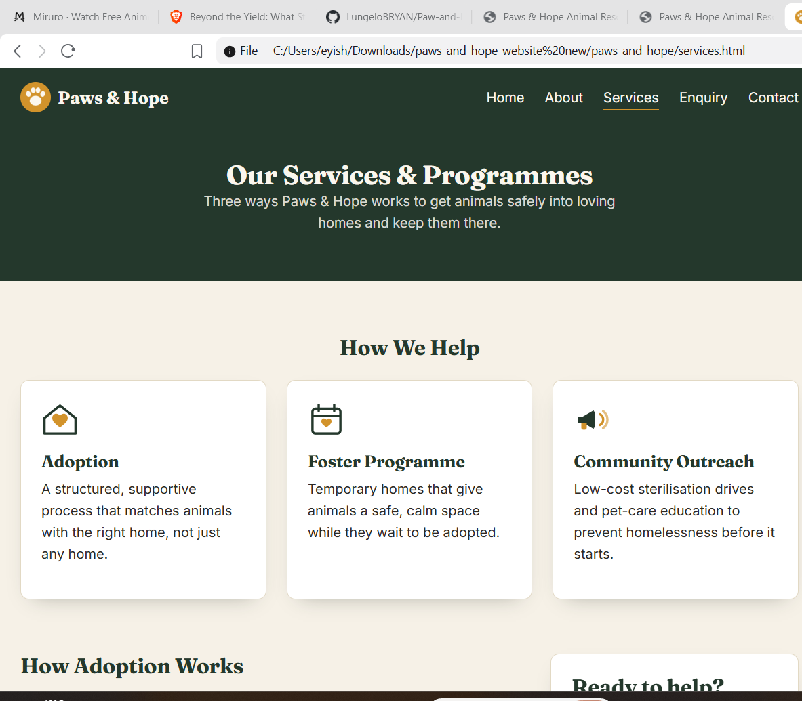
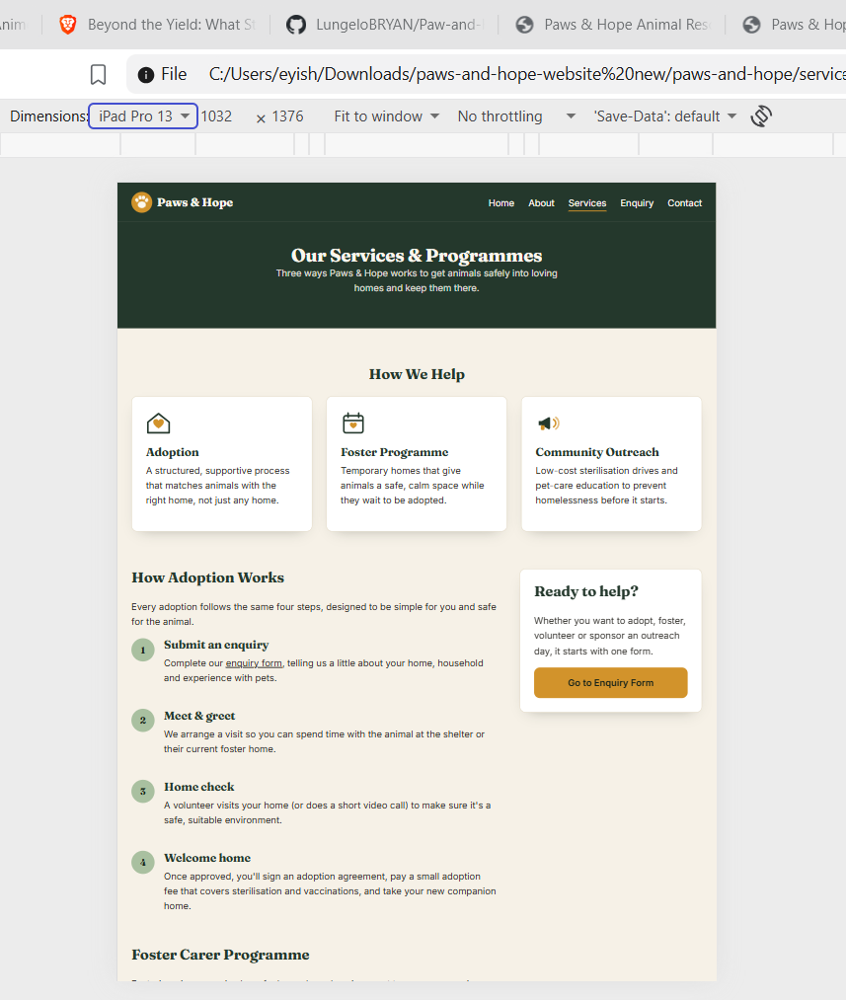
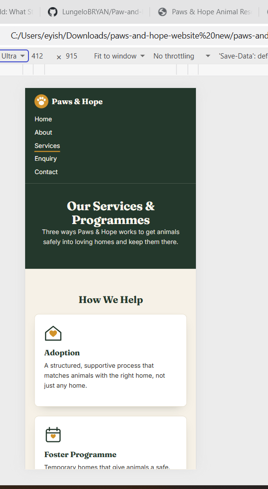
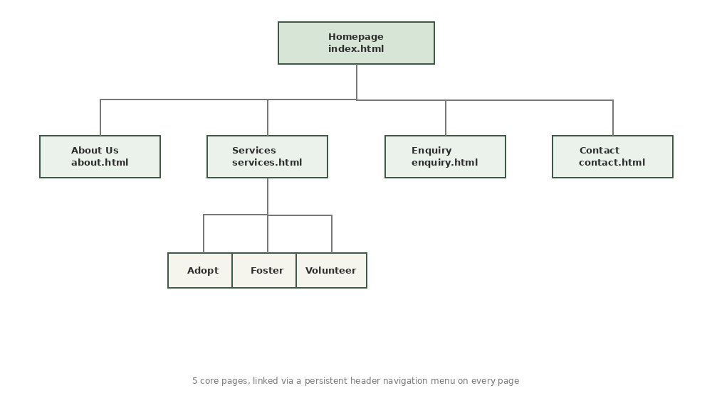

# Paws & Hope Animal Rescue — Website

## Project Title
**Paws & Hope Animal Rescue** — a 5-page brochure website built for the Web Development Portfolio of Evidence (PoE).
This repository covers **Part 1** (foundation and HTML), **Part 2** (CSS styling and responsive design) and
**Part 3** (JavaScript functionality, SEO, form validation and deployment).

**Live website:** https://lungelobryan.github.io/Paw-and-Hope/ (published with GitHub Pages; see [Deployment](#deployment))

## Student Information
| Field | Detail |
|---|---|
| Student name | Lungelo Mabindisa |
| Student number | ST10503170 |
| Group | 2 |
| Subject | Web Development (Introduction) — WEDE5020 |
| Institution | Rosebank College — International Braamfontein Campus |

## Project Overview
Paws & Hope Animal Rescue is a hypothetical, realistically researched Johannesburg-based non-profit organisation that
rescues, fosters and rehomes abandoned and at-risk companion animals. The animals, people, events, addresses and fees on
the site are made-up examples, and the footer of every page says so. The website was developed against a Website Project
Proposal that was written before any code (the proposal was submitted separately and also contains the second,
non-selected proposal for a small business, Sunrise Bakehouse). The organisation's registration and domain costs in the
proposal were based on information from CIPC (n.d.), the Department of Social Development (n.d.) and the South African
Government (n.d.).

The site serves three real audiences: **prospective adopters**, **volunteers and foster carers**, and **donors and sponsors**.

## Feedback From Earlier Parts and How It Was Addressed
| Part | Mark | Lecturer's overall comment |
|---|---|---|
| Part 1 | 96 / 100 | "Excellent work!!" |
| Part 2 | 96 / 100 | "Excellent work!!" |

The written comments for Part 2 did not list specific corrections, so there were no lecturer-requested changes to carry
out. The Part 2 submission was nevertheless checked again while preparing Part 3, and these problems were found and fixed
(each one is also recorded in the [Changelog](#changelog) under version 0.3.0):

| Problem found in the Part 2 submission | Fix |
|---|---|
| The README had backslash characters inside words and links (for example `\&`), so some text and reference links were broken | README rewritten with clean text and working links |
| The sitemap picture in the README did not display because of broken image syntax | Image syntax corrected |
| The three responsive-design screenshots were in `docs/screenshots/` but not shown in the README | Embedded in the README (see [Part 2 evidence](#part-2-evidence-responsive-screenshots)) |
| Several reference-list entries shared the same author and "(n.d.)" without a, b, c letters, and were not in alphabetical order | References re-lettered and re-ordered |
| The small amber text under animal names had a colour contrast of 3.56:1 (the minimum for small text is 4.5:1) | Darker amber for small text, now 5.7:1 |
| The "Upcoming outreach dates" table on the Services page listed dates that had already passed | New dates, and the page now hides any date that has passed |

## Website Goals and Objectives
| Goal | KPI |
|---|---|
| Increase adoption enquiries for animals in shelter or foster care | Completed adoption enquiries submitted per month |
| Recruit new volunteers and foster carers | Volunteer and foster sign-ups submitted per month |
| Grow individual and corporate donations and sponsorships | Click-through rate on donation calls-to-action; sponsor enquiries |
| Raise awareness of responsible pet ownership and sterilisation | Page views and time on the Services page; newsletter sign-ups |

## Key Features and Functionality
- **Home** (`index.html`): hero with an art-directed responsive image, impact statistics that count up, the adoption steps,
  three featured animals that open in a pop-up, and calls to action.
- **About** (`about.html`): history, mission and vision, team, and a gallery of pictures with a lightbox.
- **Services** (`services.html`): a searchable, filterable and sortable list of animals built with JavaScript, the adoption
  steps, the foster programme, a table of upcoming outreach days, and an FAQ accordion.
- **Enquiry** (`enquiry.html`): one form for adopting, fostering, volunteering or sponsoring. The questions change with the
  choice, every field is checked, and a reply about cost and availability is shown.
- **Contact** (`contact.html`): an interactive map with two locations, opening hours, and a form that builds a ready-to-send email.
- The same header (with a Menu button on phones) and footer appear on every page.

## Part 3 Details: Functionality and SEO

### JavaScript features
All JavaScript is plain ("vanilla") JavaScript with no frameworks, split into small files so each file has one job.
Every file is commented step by step.

| Feature | Page | File | How to try it |
|---|---|---|---|
| Mobile menu button | all | `js/script.js` | Make the window narrower than 600px, press **Menu**; **Esc** closes it |
| Stats count up once | Home | `js/script.js` | Scroll to the numbers (the real numbers are in the HTML, so nothing breaks without JavaScript) |
| Animal pop-up (modal) | Home, Services | `js/script.js` | Press **Meet Buddy**; **Esc**, the **×** or a click outside closes it; **Tab** stays inside it |
| FAQ accordion | Services | `js/script.js` | Press a question; opening one closes the others; arrow keys move between questions |
| Animals list built from data | Services | `js/data.js`, `js/services.js` | Open the page: all 8 cards are created by JavaScript |
| Search, filter and sort | Services | `js/services.js` | Type "rabbit", pick **Cats**, tick **available only**, change **Sort by** |
| Upcoming outreach days only | Services | `js/services.js` | Dates that have passed are removed from the table automatically |
| Gallery lightbox | About | `js/lightbox.js` | Press any picture; use the arrow buttons, the left/right arrow keys or swipe; **Esc** closes |
| Interactive map | Contact | `js/map.js` | Press **Show on map**, **Show both**, or **Find the closest to me** |
| Enquiry form logic | Enquiry | `js/forms.js` | See [Forms](#forms-validation-processing-and-email) |
| Contact form and email | Contact | `js/forms.js` | See [Forms](#forms-validation-processing-and-email) |

**Animations and transitions.** The paw prints in the home-page illustration appear one after another (CSS keyframes inside
the SVG file), the stats count up (JavaScript), the accordion slides open, and the pop-up and lightbox fade in (CSS). Buttons
and cards also have hover transitions. Anyone who asks their device for reduced motion gets no animation (`prefers-reduced-motion`).

**Advanced DOM manipulation.** Cards, table rows, the pop-up, the lightbox, the map popups and the form replies are all built
by JavaScript from data, using a small helper called `el()` in `js/script.js`. The helper uses `textContent`, never
`innerHTML`, so anything a visitor types is shown as plain text and cannot run as code (see [Security](#security)).

**Dynamic content.** The animals live in one list in `js/data.js`. The home-page pop-up, the Services list and the Enquiry
form's animal drop-down all read that same list, so adding an animal in one place updates all three.

**Interactive map.** Built with Leaflet (Leaflet, n.d.) using OpenStreetMap tiles. The OpenStreetMap credit is shown on the
map, as its tile policy requires (OpenStreetMap Foundation, n.d.). The pins are placed at the approximate centres of
Bryanston and Alexandra (Wikipedia, n.d.b; Wikipedia, n.d.a), because the street address is a made-up example. The popups
have a "Get directions" link to Google Maps. If Leaflet cannot load, the map box explains that and the addresses are still on the page.

**Accessible keyboard behaviour.** The accordion, pop-up and lightbox follow the keyboard behaviour described in the Accordion
and Dialog (Modal) patterns of the W3C ARIA Authoring Practices Guide (World Wide Web Consortium (W3C), n.d.a): buttons
with `aria-expanded`, `role="dialog"` with `aria-modal`, Esc to close, focus moved into the pop-up and handed back afterwards.

### Forms: validation, processing and email
Both forms are normal HTML forms that work with JavaScript turned on. JavaScript adds the checking and the replies.
Checks run when a visitor leaves a field, again while they fix a mistake, and again when they press the button. If anything
is wrong, a message appears under that field, the field is marked `aria-invalid`, a summary appears at the top and the first
mistake receives focus. Client-side checks make a form friendlier but are not security on their own, because a real server
must check the data again (Mozilla Developer Network, n.d.b).

| Field | Rule | Example message |
|---|---|---|
| Full name | Required, 2–60 characters, letters, spaces, apostrophes, full stops and hyphens only | "Please use letters only (spaces, hyphens and apostrophes are fine)." |
| Email address | Required, must look like `name@example.com` | "Please enter an email address like name@example.com." |
| Phone number | South African number: `082 123 4567`, `0821234567`, `+27 82 123 4567` or `0027…` (spaces, brackets and dashes are ignored). Required on Enquiry, optional on Contact | "Please enter a South African number, like 082 123 4567 or +27 82 123 4567." |
| Preferred date (Enquiry) | Required for adopt, foster and volunteer; today up to 90 days ahead; not a Sunday; the date picker also blocks other dates | "We are closed on Sundays. Please choose a day from Monday to Saturday." |
| Drop-downs | Required when shown | "Please choose an option." |
| Message | Enquiry: optional, up to 500 characters. Contact: required, 10–700 characters. A live counter shows how many are left | "Please write at least 10 characters (you have written 5)." |
| Consent tick box (Enquiry) | Required | "Please tick this box to continue." |

Questions that are hidden (for example the foster question while "adopt" is chosen) are skipped by the checks and are not sent.

**Enquiry form: processing and response.** When the form is valid it is sent in the background (AJAX) with `fetch()`
(Mozilla Developer Network, n.d.d) to the address in the form's `action` attribute, as JSON, without reloading the page.
The button shows "Sending…" and is switched off while it waits. The request gives up after 10 seconds, and a failed request
shows a clear message while keeping everything the visitor typed. This practice site posts to JSONPlaceholder, a free fake
API that replies with a reference number and keeps nothing (Typicode, n.d.); a real organisation would replace that address
with its own form service. The page then replaces the form with a reply built from the visitor's answers:

| Visitor chose | Reply includes |
|---|---|
| Adopt a particular animal | Whether that animal is available or reserved (reserved animals get a waiting-list message), the adoption fee, and the requested meet-and-greet date |
| Adopt, no preference | The three fee levels (R300 rabbits, R650 cats, R850 dogs) |
| Foster | That fostering costs nothing, the next first-Saturday orientation date (worked out from today's date), and typical length |
| Volunteer | Induction time, minimum age, and the requested start date |
| Sponsor | What the chosen amount pays for and the yearly total (for example R250 a month adds up to R3 000 a year) |

Links such as `enquiry.html?type=adopt&animal=buddy` pre-fill the form; unknown values in the link are ignored.

**Contact form: email.** This site has no mail server, so the form cannot send email by itself. When the form is valid it
builds the whole email (recipient, subject and body) and shows a preview with three buttons: **Open in my email app** (a
`mailto:` link), **Copy email text** and **Change my message**. The message's line breaks are written as CRLF and the text is
percent-encoded, as the `mailto` standard asks (Duerst, Masinter and Zawinski, 2010). The recipient is the address in the form's
`action` attribute in `contact.html` (currently `hello@pawsandhope.org.za`), so it is changed in one place.

### Search Engine Optimisation (SEO)

**Keyword research.** The keywords were chosen by working out what each audience would type to find the organisation, then
using local wording ("Johannesburg", "Bryanston", "Alexandra"). No paid tool was used, so the next step for a real
organisation would be to check them against search-volume data in Google Trends or Google Keyword Planner. Each page has one
main phrase, and it appears in that page's title, description and text:

| Page | Title | Title length | Description length | Main phrase |
|---|---|---|---|---|
| `index.html` | Animal Rescue in Johannesburg \| Adopt a Pet \| Paws & Hope | 57 | 149 | animal rescue in Johannesburg |
| `about.html` | About Us \| Johannesburg Animal Rescue NPO \| Paws & Hope | 55 | 157 | animal rescue NPO |
| `services.html` | Adopt a Pet in Johannesburg \| Paws & Hope Services | 50 | 135 | adopt a pet in Johannesburg |
| `enquiry.html` | Adoption Enquiry: Adopt, Foster or Volunteer \| Paws & Hope | 58 | 155 | adoption enquiry |
| `contact.html` | Animal Shelter in Bryanston \| Contact & Visit \| Paws & Hope | 59 | 141 | animal shelter in Bryanston |

**Title tags.** Every page has a different title that says what the page is. Titles are short (50–59 characters), say what the page is, put the brand last, and avoid repeated keywords, which Google advises against
(Google Search Central, n.d.d).

**Meta descriptions.** Every page has its own description written as a sentence. Google sometimes uses the description as the
text under a result, wants a different one on each page, and has no length limit but shortens snippets to fit the screen
(Google Search Central, n.d.b), so each one is kept short:

| Page | Meta description |
|---|---|
| `index.html` | Paws & Hope is an animal rescue in Johannesburg. Adopt a dog, cat or rabbit, foster an animal in need, volunteer or sponsor our sterilisation drives. |
| `about.html` | Meet the volunteers behind Paws & Hope, a registered Johannesburg animal rescue NPO founded in 2015. Read our story and mission, and see the animals we help. |
| `services.html` | Adopt a pet in Johannesburg: search our dogs, cats and rabbits by species or name, learn how fostering works and see our outreach days. |
| `enquiry.html` | Send an adoption enquiry, or ask about fostering, volunteering or sponsoring at Paws & Hope. Answer a few short questions and we reply in two working days. |
| `contact.html` | Visit our animal shelter in Bryanston or the monthly adoption day in Alexandra. Find both on the map, see opening hours or send us a message. |

**Meta keywords.** Every page also has a `keywords` meta tag, because the brief asks for one. Google has said since 2009 that it
does not use this tag for ranking (Cutts, 2009), so the visible text, titles and descriptions above matter far more:

| Page | Keywords |
|---|---|
| `index.html` | animal rescue in Johannesburg, pet adoption Johannesburg, adopt a dog, adopt a cat, animal shelter Bryanston, foster a pet, volunteer animal shelter, Paws & Hope |
| `about.html` | about Paws & Hope, animal rescue NPO Johannesburg, animal shelter history, rescue volunteers, animal rescue mission |
| `services.html` | adopt a pet in Johannesburg, foster carer programme, pet sterilisation drive, animal outreach Alexandra, dogs for adoption, cats for adoption, rabbits for adoption |
| `enquiry.html` | adoption enquiry, adopt a pet, foster an animal, volunteer Johannesburg, sponsor animal rescue, donate animal shelter |
| `contact.html` | animal shelter in Bryanston, contact animal rescue Johannesburg, shelter opening hours, adoption day Alexandra, Paws & Hope contact |

**Header tags.** Every page has exactly one `h1`, then `h2` sections and `h3` sub-sections with no levels skipped. The footer
headings are paragraphs, so they do not clutter the page outline.

**Image optimisation.** Images have descriptive, lowercase, hyphenated file names and descriptive alt text, as Google advises
(Google Search Central, n.d.c). Every image written in the page HTML has `width` and `height` (images that JavaScript or Leaflet adds later are sized by CSS). The images are original illustrations made for this project
(no third-party images, so no licensing issue; see Creative Commons (n.d.) for how photos would be handled).

| File | Alt text | Used on |
|---|---|---|
| `paws-and-hope-logo.svg` | Paws and Hope paw-print logo | `index.html` |
| `rescue-dog-and-cat-hero.svg` | Illustration of a dog and a cat sitting side by side beneath the sun | `index.html` |
| `buddy-brown-mixed-breed-dog.svg` | Illustration of Buddy, a scruffy brown mixed-breed dog | `index.html` |
| `nala-ginger-shorthair-cat.svg` | Illustration of Nala, a ginger shorthair cat with white whiskers | `index.html` |
| `thistle-grey-rabbit.svg` | Illustration of Thistle, a grey rabbit with tall ears | `index.html` |
| `zola-golden-labrador-cross-dog.svg` | Illustration of Zola, a golden labrador-cross dog with floppy ears | `about.html` |
| `max-senior-black-dog.svg` | Illustration of Max, a senior black dog with a grey muzzle | `about.html` |
| `pepper-grey-kitten.svg` | Illustration of Pepper, a grey kitten with big dark eyes | `about.html` |
| `tigger-brown-tabby-cat.svg` | Illustration of Tigger, a brown tabby cat | `about.html` |
| `clover-white-rabbit.svg` | Illustration of Clover, a white rabbit with pink inner ears | `about.html` |
| `adopt-a-pet-icon.svg` | House icon with a heart, representing adoption | `services.html` |
| `foster-programme-icon.svg` | Calendar icon with a heart, representing the foster programme | `services.html` |
| `community-outreach-icon.svg` | Megaphone icon, representing community outreach | `services.html` |

*Renamed in Part 3 for SEO:* `avatar-dog.svg` → `buddy-brown-mixed-breed-dog.svg`, `avatar-cat.svg` → `nala-ginger-shorthair-cat.svg`,
`avatar-rabbit.svg` → `thistle-grey-rabbit.svg`, `hero-art.svg` → `rescue-dog-and-cat-hero.svg`, `hero-art-mobile.svg` →
`rescue-dog-and-cat-hero-mobile.svg`, `logo-mark.svg` → `paws-and-hope-logo.svg`, `icon-adopt.svg` → `adopt-a-pet-icon.svg`,
`icon-foster.svg` → `foster-programme-icon.svg`, `icon-outreach.svg` → `community-outreach-icon.svg`, `icon-volunteer.svg` →
`volunteer-icon.svg`, `paw-solo.svg` → `paw-print-icon.svg`. (`favicon.svg` keeps its conventional name.)

**URL structure.** Page addresses are short, lowercase and readable (`services.html`, `enquiry.html`, `contact.html`) and image
files are hyphenated with no spaces.

**Internal linking.** Pages link to each other from the body text, not only from the menu:

| Page | Links from the main content to other pages |
|---|---|
| `index.html` | `about.html`, `contact.html`, `enquiry.html`, `services.html` |
| `about.html` | `contact.html`, `enquiry.html`, `index.html`, `services.html` |
| `services.html` | `contact.html`, `enquiry.html`, `index.html` |
| `enquiry.html` | `index.html`, `services.html` |
| `contact.html` | `enquiry.html`, `index.html`, `services.html` |

**Mobile-friendliness.** The layout is responsive (Part 2), the page has a viewport tag, there is a Menu button on phones, and
no page scrolls sideways at 375px wide.

**Off-page SEO (plan only).** Paws & Hope is fictional, so these were not carried out; this is what a real organisation would do.
*Backlinks:* ask local vets, pet shops and animal-welfare directories to link to the site. *Social media:* share adoption posts
with a link back, using the page titles and descriptions above (Open Graph tags are already in each page's `<head>` so shared links look right).
*Local SEO:* create a Google Business Profile, keep the name, address and phone number identical everywhere (they are the same in the
footer and on the Contact page), and keep local words in titles and headings.

**robots.txt and sitemap.xml.** `robots.txt` allows crawlers to visit the pages, keeps them out of the `docs/` folder (screenshots only)
and points to the sitemap (Google Search Central, n.d.e). `sitemap.xml` lists the five pages with a priority and update frequency
(Google Search Central, n.d.a). Search engines only read `robots.txt` at the very top of a web address, so on a GitHub Pages
project address (which has `/Paw-and-Hope/` in it) this file is for demonstration; on a site with its own domain it would work as written.
If the site moves, change the address in `sitemap.xml` and `robots.txt`.

**Page speed.** Scripts are at the end of the page, so they do not block it from showing. Font servers are pre-connected, fonts use
`display=swap`, the first image is marked high priority, images below the first screen use `loading="lazy"`, and the images in the HTML have sizes
so the page does not jump while loading. Leaflet loads only on the Contact page. Sizes before compression (fonts and the
Leaflet library are loaded from other servers and are not counted):

| Page | HTML (KB) | CSS (KB) | JavaScript (KB) | Images (KB) | Total (KB) |
|---|---|---|---|---|---|
| `index.html` | 10.2 | 31.2 | 16.5 | 9.2 | 67.1 |
| `about.html` | 11.5 | 31.2 | 14.3 | 8.5 | 65.5 |
| `services.html` | 15.4 | 31.2 | 21.9 | 2.4 | 70.9 |
| `enquiry.html` | 13.0 | 31.2 | 39.1 | 0.7 | 84.0 |
| `contact.html` | 11.8 | 31.2 | 45.1 | 0.7 | 88.8 |

#### Security
- The Leaflet files are loaded with an `integrity` hash, so the browser refuses them if they were changed (the hashes are the ones in the Leaflet guide (Leaflet, n.d.)).
- Everything a visitor types is shown with `textContent`; the JavaScript contains no `innerHTML`, no `eval` and no inline event handlers.
- Every field has a length limit and a check; client-side checks are not security on their own (Mozilla Developer Network, n.d.b).
- Links that open a new tab use `rel="noopener noreferrer"`, and each page sets a referrer policy.
- The enquiry form only sends data to a public practice server, and the form tells visitors not to enter real personal details.
- GitHub Pages serves sites over HTTPS; tick **Enforce HTTPS** in the Pages settings if it is offered.
- Not done: a Content-Security-Policy, which would be a sensible next step for a real organisation.

**Accessibility check.** An automated accessibility scan (axe-core, WCAG 2 A and AA rules plus best practices) was run on all five pages
at desktop and phone width and on the pop-up, lightbox, error messages, replies and open accordion. It found one problem (the
amber text contrast, above), which was fixed, and then no problems. Automated scans do not replace testing with a keyboard and a
screen reader. The WCAG 2 guidelines are summarised by the World Wide Web Consortium (W3C) (n.d.b).

### Deployment
The site is published free with **GitHub Pages** (GitHub, n.d.), which publishes the static files straight from this repository.
Free accounts can publish Pages only from a public repository. The steps used:

1. Open the repository on GitHub, then **Settings** → **Pages**.
2. Under **Build and deployment**, choose **Deploy from a branch**, branch **main**, folder **/ (root)**, then **Save**.
3. Wait a few minutes, then open https://lungelobryan.github.io/Paw-and-Hope/.
4. Click through all five pages, try the forms, and check the map and images load.

The empty file `.nojekyll` in the root turns off GitHub's Jekyll build, which this plain HTML site does not need (GitHub, n.d.).

### Testing
Each feature in the table at the top of this section lists a way to try it. In addition, during development the site was run
through an automated browser test in Chromium (the engine behind Chrome and Edge) covering every feature above, including keyboard
use, phone width, reduced motion, a failing or slow server, the date rules and the email text. It does not cover real map tiles,
the live JSONPlaceholder server, real email apps or GitHub Pages, so check those by hand after deployment:

| Check | Expected result |
|---|---|
| Open the live site and click every menu link | All five pages load with no broken images |
| Contact page | The map shows streets, two pins and the OpenStreetMap credit |
| Enquiry page, press **Send enquiry** with nothing filled in | A summary and red messages appear and nothing is sent |
| Enquiry page with valid answers | A "Thank you" reply with a reference number appears |
| Contact page with valid answers | "Your email is ready", and **Open in my email app** opens a filled-in email to the recipient |
| Phone width (about 375px) | **Menu** button works, nothing scrolls sideways |
| Press Tab through a page | A visible outline follows the focus |

## Part 2 Evidence: Responsive Screenshots
Screenshots of the home page at three widths, taken with the browser's developer tools.





Part 2 used a CSS reset, design tokens (CSS custom properties), a type scale in `rem`, Flexbox (header, navigation, hero) and CSS Grid
(card rows, statistics, content and sidebar, and a footer with named grid areas), `:hover`, `:focus-visible` and `:active` states,
two breakpoints (tablet 900px and mobile 600px) with relative units, and a `<picture>` element that serves a tighter crop of the
hero illustration on phones. The techniques follow the Mozilla Developer Network guides to Flexbox (n.d.a), CSS grid layout (n.d.c),
media queries (n.d.f) and the picture element (n.d.g). The pages use the semantic HTML5 elements listed by the same site (n.d.e).

## Part 3 Screenshots
| | |
|---|---|
|  |  |
| Animal pop-up on the home page | Gallery lightbox on the About page |
|  |  |
| Services list filtered to cats, youngest first | FAQ accordion with one answer open |
|  |  |
| Enquiry form with validation messages | Enquiry reply about cost and availability |
|  |  |
| Contact form: email ready to send | Mobile menu open |

The map is not shown here because the screenshots were taken without access to the map tile server; it can be seen on the live site.

## Timeline and Milestones
| Stage | Target Window | Milestone |
|---|---|---|
| Part 1 | Weeks 1–4 | Proposal approval, content research, sitemap, file and folder structure, five semantic HTML pages on GitHub (**96/100**) |
| Part 2 | Weeks 5–8 | CSS styling, Grid and Flexbox layout, responsive breakpoints, responsive images (**96/100**) |
| Part 3 | Weeks 9–12 | JavaScript features, SEO, form validation, email and enquiry processing, deployment *(this submission)* |

## Sitemap


```
Homepage (index.html)
├── About (about.html)            gallery with lightbox
├── Services (services.html)      animal search, adoption steps, foster programme, outreach days, FAQ
├── Enquiry (enquiry.html)        adopt / foster / volunteer / sponsor form
└── Contact (contact.html)        interactive map, opening hours, message form
```

Every page shares the same header menu and footer, so any page is one click from any other. The machine-readable version for search
engines is `sitemap.xml`.

## File and Folder Structure
```
paws-and-hope/
├── index.html
├── about.html
├── services.html
├── enquiry.html
├── contact.html
├── robots.txt
├── sitemap.xml
├── .nojekyll
├── css/
│   └── style.css
├── js/
│   ├── data.js         animals + outreach days + small helper functions
│   ├── script.js       shared: helper, menu, counters, accordion, animal pop-up
│   ├── services.js     animal list, search/filter/sort, upcoming events
│   ├── lightbox.js     gallery lightbox
│   ├── map.js          Leaflet map
│   └── forms.js        validation, enquiry processing + AJAX, contact email
├── images/             descriptive file names (see the table above)
├── docs/
│   ├── sitemap.png
│   └── screenshots/
│       ├── desktop.png, tablet.png, mobile.png     (Part 2)
│       └── part3/                                  (Part 3 feature screenshots)
└── README.md
```

## Changelog
All notable changes are recorded below, newest first, and match the commit history of this repository.

### [0.3.0] — Part 3: functionality, SEO, forms and deployment
**Feedback**
- Recorded the Part 2 mark (96/100) and comment ("Excellent work!!"). The comment named no corrections, so the Part 2 submission was re-checked and the problems in the table near the top of this file were fixed.

**Added: interactive features**
- `js/script.js` (replaced the empty placeholder): `el()` helper, mobile menu, stat counters, FAQ accordion, animal pop-up with focus handling.
- `js/data.js`: the animals (8, with age, fee and status) and outreach days, plus helper functions for age, money and dates.
- `js/services.js`: animal list built from data with search, species filter, "available only", four sort orders and a "Showing X of 8" count; outreach table that hides past dates.
- `js/lightbox.js`: gallery lightbox with previous/next buttons, arrow keys, swipe, Escape, focus trap and focus return.
- `js/map.js`: Leaflet map with two markers and popups, "Show on map", "Show both", and "Find the closest to me" with friendly messages when location is blocked or slow.
- Five new animal illustrations (Zola, Max, Pepper, Tigger, Clover) made by recolouring the originals; the hero paw prints now animate.
- `.nojekyll`, ready for GitHub Pages.

**Added: forms**
- `js/forms.js`: field checks (name, email, South African phone, date rules, message length, drop-downs, consent), live checking, error summary, focus on the first mistake, character counters.
- Enquiry: questions that change with the chosen type, an animal drop-down filled from the data, links that pre-fill the form, AJAX submission with `fetch()` (10-second timeout, error handling), and a reply about cost and availability.
- Contact: new fields (phone, message type), and an email builder with preview, "Open in my email app", "Copy email text" and "Change my message".

**Added: SEO**
- Unique title, description and keywords on every page, with each page's main phrase in the title, description and text; `lang="en-ZA"`; Open Graph tags.
- `robots.txt` and `sitemap.xml`; breadcrumbs and more links between pages; `loading="lazy"`, `fetchpriority` and font pre-connect for speed.

**Changed**
- Images renamed with descriptive file names (list in the SEO section) and alt text rewritten; every reference in the pages and scripts was updated.
- Header: added the Menu button and `id` for the navigation; footer headings changed from `h2` to paragraphs; footer text now says the organisation is fictional.
- Services page: new animals section and FAQ; outreach dates replaced with future dates.
- Contact page: the two Google Maps iframes were replaced by the Leaflet map (the page-specific styles that were inside `contact.html` moved into `css/style.css`).
- Animal card images use a taller crop so rabbit ears are not cut off; phone numbers cannot break across lines.
- Date and money text is now built by the site's own code, so it looks the same in every browser (browsers format `toLocaleString` differently).

**Fixed**
- Small amber text contrast raised from 3.56:1 to 5.7:1 (found by the accessibility scan).
- The email body now uses CRLF line breaks, as the `mailto` standard asks.
- The animal search form now has a real **Search** button.
- README: backslash characters removed, sitemap picture fixed, Part 2 screenshots embedded, references re-lettered and re-ordered.

### [0.2.0] — Part 2: CSS styling and responsive design
- **Added:** full rewrite of `css/style.css` (reset, design tokens, type scale, Flexbox and Grid layout, `:hover`/`:focus-visible`/`:active` states, tablet and mobile breakpoints in relative units).
- **Added:** `hero-art-mobile.svg` and a `<picture>` element for an art-directed mobile hero; `srcset` and `sizes` on animal cards.
- **Changed:** markup on all five pages to match the new layout; content unchanged from Part 1.
- **Added:** Part 2 screenshots (`docs/screenshots/desktop.png`, `tablet.png`, `mobile.png`).

### [0.1.1] — Simplified to match Part 1 scope
- **Removed:** the mobile menu button and all JavaScript, deferred to later parts; the responsive breakpoint that supported it.
- **Changed:** header and navigation used simple `inline-block` elements; footer year became static text.

### [0.1.0] — Part 1 submission
- **Added:** global stylesheet, original SVG artwork, five semantic HTML5 pages with written content, content research package, and this README.
- **Fixed:** a CSS selector (`.stats div`) that also matched the page container, which made the statistic boxes overlap.

## References
Harvard style. Sources are cited in the text above as (Author, year).

CIPC (n.d.) *Domain Name Registration*. Available at: https://www.cipc.co.za/?page_id=4565 (Accessed: 14 August 2026).

Creative Commons (n.d.) *About CC Licenses*. Available at: https://creativecommons.org/share-your-work/cclicenses/ (Accessed: 14 August 2026).

Cutts, M. (2009) *Google does not use the keywords meta tag in web ranking*. Google Search Central Blog, 21 September. Available at: https://developers.google.com/search/blog/2009/09/google-does-not-use-keywords-meta-tag (Accessed: 2 November 2026).

Department of Social Development (n.d.) *About Us — Register of Nonprofit Organisations in South Africa*. Available at: https://www.dsd.gov.za/index.php/npo/about-us (Accessed: 14 August 2026).

Duerst, M., Masinter, L. and Zawinski, J. (2010) *The 'mailto' URI scheme*. RFC 6068. Internet Engineering Task Force. Available at: https://www.rfc-editor.org/rfc/rfc6068 (Accessed: 2 November 2026).

GitHub (n.d.) *Creating a GitHub Pages site*. Available at: https://docs.github.com/en/pages/getting-started-with-github-pages/creating-a-github-pages-site (Accessed: 2 November 2026).

Google Search Central (n.d.a) *Build and submit a sitemap*. Available at: https://developers.google.com/search/docs/crawling-indexing/sitemaps/build-sitemap (Accessed: 2 November 2026).

Google Search Central (n.d.b) *Control your snippets in search results*. Available at: https://developers.google.com/search/docs/appearance/snippet (Accessed: 2 November 2026).

Google Search Central (n.d.c) *Google image SEO best practices*. Available at: https://support.google.com/webmasters/answer/114016 (Accessed: 2 November 2026).

Google Search Central (n.d.d) *Influencing your title links in search results*. Available at: https://developers.google.com/search/docs/appearance/title-link (Accessed: 2 November 2026).

Google Search Central (n.d.e) *Introduction to robots.txt*. Available at: https://developers.google.com/search/docs/crawling-indexing/robots/intro (Accessed: 2 November 2026).

Leaflet (n.d.) *Leaflet Quick Start Guide*. Available at: https://leafletjs.com/examples/quick-start/ (Accessed: 2 November 2026).

Mozilla Developer Network (n.d.a) *Basic concepts of flexbox*. Available at: https://developer.mozilla.org/en-US/docs/Web/CSS/CSS_flexible_box_layout/Basic_concepts_of_flexbox (Accessed: 18 September 2026).

Mozilla Developer Network (n.d.b) *Client-side form validation*. Available at: https://developer.mozilla.org/en-US/docs/Learn_web_development/Extensions/Forms/Form_validation (Accessed: 2 November 2026).

Mozilla Developer Network (n.d.c) *CSS grid layout*. Available at: https://developer.mozilla.org/en-US/docs/Web/CSS/CSS_grid_layout (Accessed: 18 September 2026).

Mozilla Developer Network (n.d.d) *Fetch API*. Available at: https://developer.mozilla.org/en-US/docs/Web/API/Fetch_API (Accessed: 2 November 2026).

Mozilla Developer Network (n.d.e) *HTML elements reference*. Available at: https://developer.mozilla.org/en-US/docs/Web/HTML/Reference/Elements (Accessed: 14 August 2026).

Mozilla Developer Network (n.d.f) *Media query*. Available at: https://developer.mozilla.org/en-US/docs/Glossary/Media_query (Accessed: 18 September 2026).

Mozilla Developer Network (n.d.g) *\<picture\>: The Picture element*. Available at: https://developer.mozilla.org/en-US/docs/Web/HTML/Element/picture (Accessed: 18 September 2026).

OpenStreetMap Foundation (n.d.) *Tile Usage Policy*. Available at: https://operations.osmfoundation.org/policies/tiles/ (Accessed: 2 November 2026).

South African Government (n.d.) *Register a nonprofit organisation*. Available at: https://www.gov.za/services/register-nonprofit-organisation (Accessed: 14 August 2026).

Typicode (n.d.) *The free fake REST API, since 2013* [JSONPlaceholder]. Available at: https://jsonplaceholder.typicode.com/ (Accessed: 2 November 2026).

Wikipedia (n.d.a) *Alexandra, South Africa*. Available at: https://en.wikipedia.org/wiki/Alexandra,_South_Africa (Accessed: 2 November 2026).

Wikipedia (n.d.b) *Bryanston, Gauteng*. Available at: https://en.wikipedia.org/wiki/Bryanston,_Gauteng (Accessed: 2 November 2026).

World Wide Web Consortium (W3C) (n.d.a) *ARIA Authoring Practices Guide (APG): Patterns*. Web Accessibility Initiative (WAI). Available at: https://www.w3.org/WAI/ARIA/apg/patterns/ (Accessed: 2 November 2026).

World Wide Web Consortium (W3C) (n.d.b) *WCAG 2 at a Glance*. Web Accessibility Initiative (WAI). Available at: https://www.w3.org/WAI/standards-guidelines/wcag/glance/ (Accessed: 14 August 2026).
